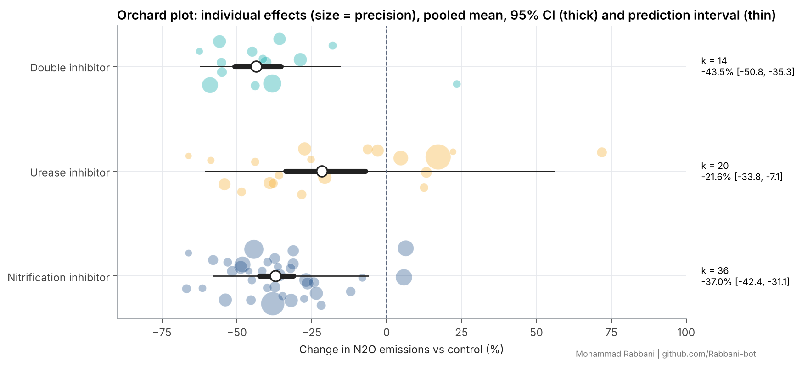

# Meta-analysis of nitrogen inhibitors: N2O emissions vs crop yield

[](https://github.com/Rabbani-bot/meta-analysis-nitrogen-inhibitors/actions/workflows/tests.yml)  

> **Study design: parameter-recovery validation.** A complete MetaWin/metafor-style meta-analysis of 70 effect sizes from 43 field trials generated from known parameters, so the accuracy of every estimator can be verified against the true effects. A publication filter withholds 16 small, non-significant trials to reproduce the publication bias found in real literature.



## What it covers
| Step | Method |
|---|---|
| Effect size | Log response ratio (lnRR) with its sampling variance (Hedges et al. 1999) |
| Pooling | Fixed effect, DerSimonian-Laird, REML (Fisher scoring), Knapp-Hartung adjustment |
| Heterogeneity | Q, I2, H2, tau2, 95% prediction interval |
| Moderators | Subgroup Q_between (inhibitor, crop, climate, soil texture); mixed-effects meta-regression (N rate + inhibitor) |
| Publication bias | Contour-enhanced funnel plot, Egger regression, trim-and-fill (L0), Rosenthal fail-safe N |
| Robustness | Leave-one-out, cumulative meta-analysis, bias-corrected bootstrap (2,000 resamples), study-level aggregation for non-independence |
| Validation | The engine reproduces metafor's published BCG-vaccine benchmark (REML -0.7145, tau2 0.3132, I2 92.22%) and passes 7 unit tests |

## Key results
| Metric | Value |
|---|---|
| Pooled N2O change (REML + Knapp-Hartung) | **-34.6%** (95% CI -39.5 to -29.3; 95% PI -61.0 to +9.9) |
| Heterogeneity | I2 = 67.5%, tau2 = 0.066, Q(69) = 237.8, p < 0.001 |
| Pooled yield change | **+3.9%** (no yield penalty) |
| Inhibitor type | NI -37.0%, UI -21.6%, double -43.5%; Q_between = 11.3, p = 0.004 |
| Crop / climate / soil | Not significant (p = 0.54 / 0.27 / 0.18) |
| Meta-regression | N rate and inhibitor type explain 56% of heterogeneity |
| Egger test | intercept -1.32, p = 0.034, indicating small-study asymmetry |
| Trim-and-fill | 19 studies imputed on the right; the adjusted effect is **-24.6%** |
| Bootstrap 95% CI | -39.1% to -29.0% |
| Leave-one-out range | -35.4% to -33.9% |
| Study-level aggregation (k = 43) | -35.0%, robust to non-independence |

**Recovery check.** The double inhibitor (true -39%) and the nitrification inhibitor (true -36% at 150 kg N) are recovered within their CIs. The urease inhibitor appears stronger than its true value (-21.6% vs -11.3%). The meta-regression N-rate slope is also about double the truth. Both distortions come from the deliberately injected publication bias, and the Egger test and trim-and-fill correctly flag it. The lesson is to report the bias-adjusted range alongside the pooled mean.

## Figures (`outputs/figures/`)
1. Orchard plot: effects, CI and prediction interval by inhibitor
2. Paired forest plots of N2O and yield
3. Contour-enhanced funnel plot with trim-and-fill
4. Meta-regression bubble plot (N rate)
5. Cumulative meta-analysis
6. Leave-one-out and bootstrap distribution
7. Win-win quadrant (yield vs N2O)
8. Moderator subgroup forest plot

Tables: `table1_overall_models.csv`, `table2_subgroups.csv`, `table3_metaregression.csv`, `table4_moderators.csv`; everything else is in `results.json`.

## Run
```bash
pip install numpy pandas scipy matplotlib
python src/analyze.py        # regenerates data, tables and figures
python -m pytest tests       # benchmark validation
```

## Links
- Kaggle notebook: https://www.kaggle.com/rabbani0123 (runnable copy of `notebook.ipynb`)
- Cite: see `CITATION.cff`
- Author: Mohammad Rabbani | Sustainability Data Analyst & Research Assistant

## License
MIT
